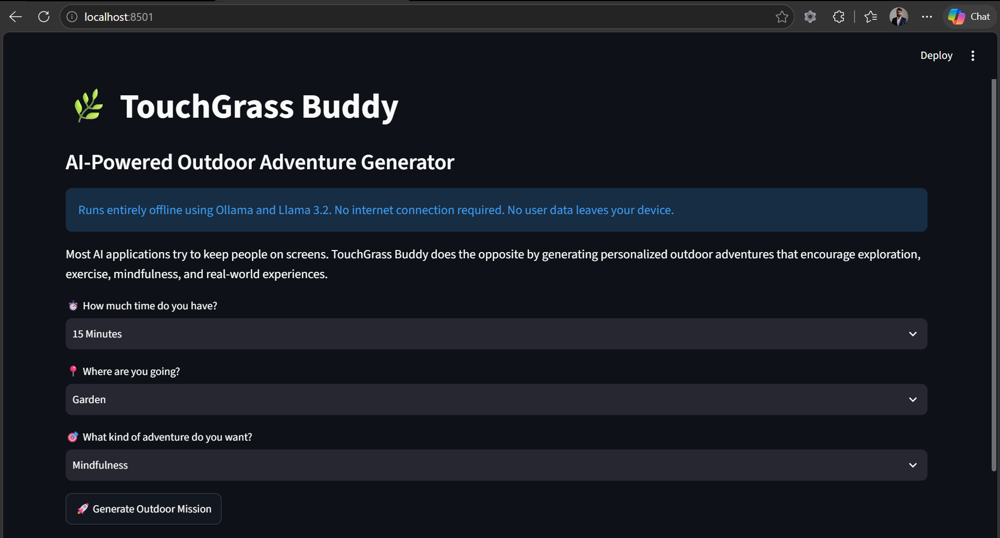
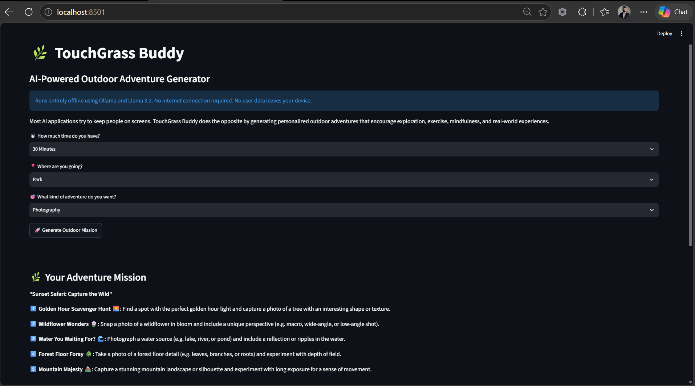
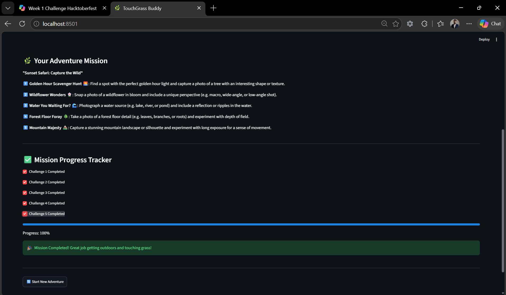

# 🌿 TouchGrass Buddy

## AI-Powered Outdoor Adventure Generator

TouchGrass Buddy is a local AI-powered application that generates personalized outdoor adventures based on your available time, location, and interests.

Most AI applications are designed to keep users glued to screens. TouchGrass Buddy does the opposite by encouraging exploration, mindfulness, exercise, creativity, and real-world experiences.

Built using:

- 🐍 Python
- 🎈 Streamlit
- 🦙 Ollama
- 🤖 Llama 3.2

---

## ✨ Features

- Generate personalized outdoor adventures
- Multiple adventure styles
  - Nature Exploration
  - Photography
  - Fitness
  - Family Fun
  - Mindfulness
- Progress tracking
- Mission completion tracking
- Start new adventure anytime
- Completely offline
- No API keys required
- No cloud dependencies
- Privacy-friendly
- Powered by open-source AI

---

## 🖼️ Screenshots

### Home Screen



### Generated Mission



### Mission Complete



---

## 🚀 How It Works

1. Choose how much time you have available.
2. Choose where you're going.
3. Select an adventure type.
4. Generate a personalized outdoor mission using a local AI model.
5. Complete the challenges.
6. Track your progress.
7. Start a new adventure whenever you're ready.

---

## 💡 Why Open-Source AI?

For this project, open-source AI was a better choice than a closed AI service because the application can run entirely on a laptop without an internet connection. Users do not need API keys, subscriptions, or cloud access, and their prompts never leave the device. This makes the solution private, portable, and cost-effective.

### Open AI Stack

- Ollama for local inference
- Llama 3.2 as the language model
- Streamlit for the user interface

### Benefits

✅ Runs completely offline

✅ No internet connection required

✅ No API costs

✅ No vendor lock-in

✅ No user data leaves the device

✅ Users remain in complete control of their data

✅ Models can be replaced or customized

This demonstrates how open-source AI can enable private, affordable, and accessible applications without relying on cloud-hosted AI services.

---

## 🌳 Touch Grass Challenge Alignment

This project was built for the Hacktoberfest 2026 Open-Source AI Challenge.

### Theme: Touch Grass

The challenge encourages building applications that use open-source AI to help people spend less time online and more time engaging with the real world.

TouchGrass Buddy aligns with this goal by:

- Using local open-source AI
- Encouraging outdoor exploration
- Promoting physical activity
- Supporting mindfulness and nature appreciation
- Keeping screen interaction brief and purposeful

The ideal user journey is:

```text
Generate Mission
       ↓
Go Outside
       ↓
Complete Challenges
       ↓
Track Progress
       ↓
Start New Adventure
```

The screen should be the shortest part of the experience.

---

## ⚙️ Installation

### Clone the Repository

```bash
git clone https://github.com/vhudlikar/touchgrass-buddy.git
cd touchgrass-buddy
```

### Install Dependencies

```bash
pip install -r requirements.txt
```

### Install Ollama

Download and install Ollama:

https://ollama.com

### Pull Llama 3.2

```bash
ollama pull llama3.2
```

### Start Ollama

```bash
ollama serve
```

### Run the Application

```bash
streamlit run app.py
```

---

## 🛠️ Technology Stack

- Python
- Streamlit
- Ollama
- Llama 3.2
- Git
- GitHub

---

## 🔮 Future Enhancements

- GPS-aware adventures
- Mobile-friendly interface
- Nature scavenger hunts
- Achievement badges
- Group challenges
- Route-based adventures
- Local park recommendations
- Wellness and fitness integrations

---

## 🤝 Contributing

Contributions are welcome.

If you have ideas, improvements, or bug fixes:

1. Fork the repository
2. Create a feature branch
3. Commit your changes
4. Open a pull request

---

## 📜 License

This project is licensed under the MIT License.

See the LICENSE file for details.

---

## 👨‍💻 Author

Viraj Hudlikar

Built as part of Hacktoberfest 2026 to explore how local open-source AI can encourage people to spend more time outdoors and less time staring at screens.

---

## 🎃 Hacktoberfest 2026

**Challenge Theme:** Touch Grass

Using local open-source AI to create real-world outdoor adventures instead of more screen time.